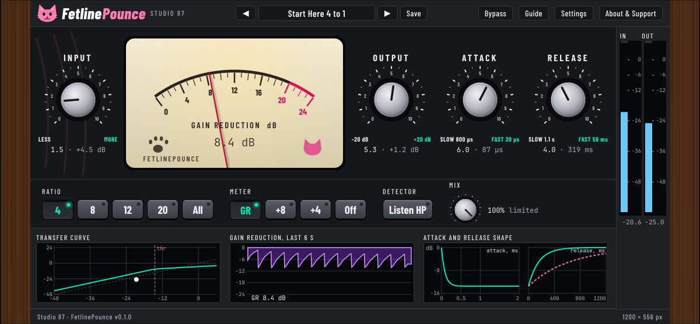

# FetlinePounce

A free, open source, cat-themed FET style limiting amplifier (VST3) by Studio 87: fast, punchy compression for drums, vocals, bass and buses.

The real plugin window, rendered offscreen from the compiled editor.

## Status
Test build (v0.1.0, pre-release). The DSP core passes its own tests (levels, ratios, latency, aliasing, stability, bypass). The installers and the plugin have not been tried on real machines or in real DAWs yet; only CI (build and pluginval) has run them.

## Features
- Ratios 4, 8, 12, 20 and the all-buttons mode; Input, Output, Attack, Release, Mix; Listen HP (detector only).
- 2x oversampled saturation, exact latency reporting (30 samples at 44.1/48 kHz, 0 at 88.2 kHz and up), bit-exact bypass.
- Needle meter (GR, +8, +4, Off), transfer curve, gain reduction history, attack and release shape, in/out meters with a dB scale.
- 16 factory presets; save, rename, delete, export and import your own.
- Resizable from every side and corner; double-click the wood to return to 100 %. Info bubbles on every control (can be turned off).

## Download
Get the zip from the [Releases](https://github.com/SpeakingColors/fetlinepounce/releases) page. It holds a Windows installer, a macOS package, a Linux Flatpak extension and a plain VST3 tarball, plus the PDF manual and INSTALL.txt.

The installers are not code signed, so Windows (SmartScreen) and macOS (Gatekeeper) will warn. Signing needs paid certificates; this project is free. Windows: More info, then Run anyway. macOS: System Settings, Privacy and Security, Open Anyway. Checksums are in SHA256SUMS.

## Build
`sh tests/run.sh` runs the core tests. The plugin builds with CMake and JUCE (fetched automatically): `cmake -S . -B build && cmake --build build`.

## Privacy
Collects nothing. No network access.

## Support

  

Free and open source, made by one person. If it helps your music, a coffee on [Ko-fi](https://ko-fi.com/studio87) keeps it coming.

## License
AGPL-3.0-or-later, see [LICENSE](LICENSE). Built with JUCE.
